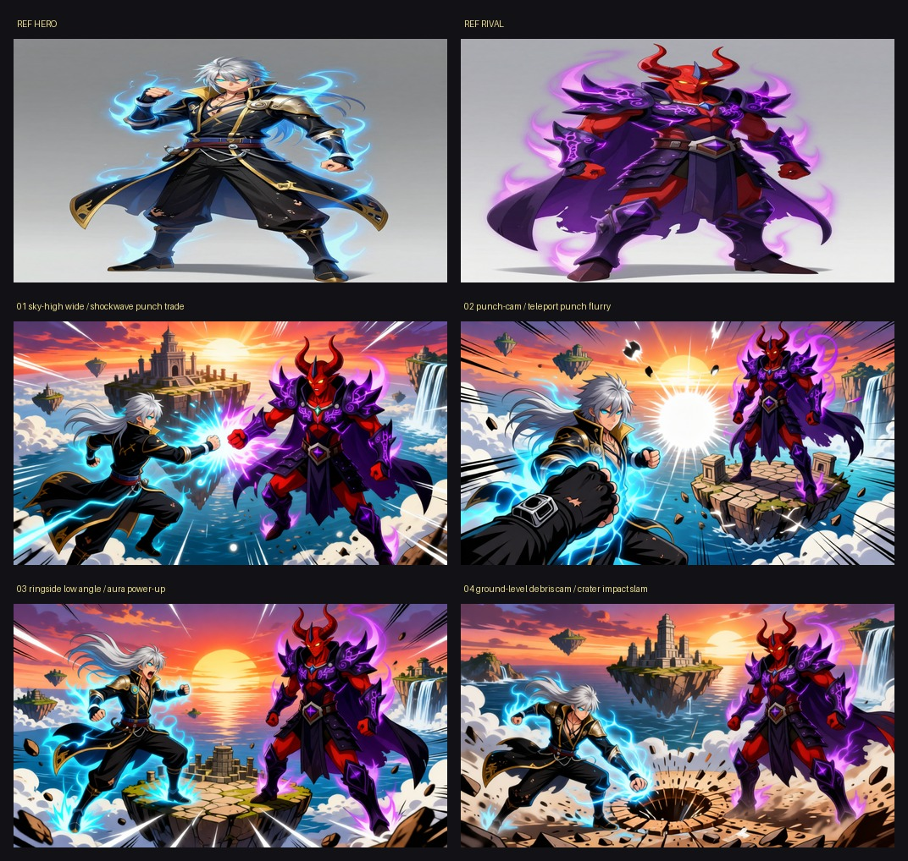
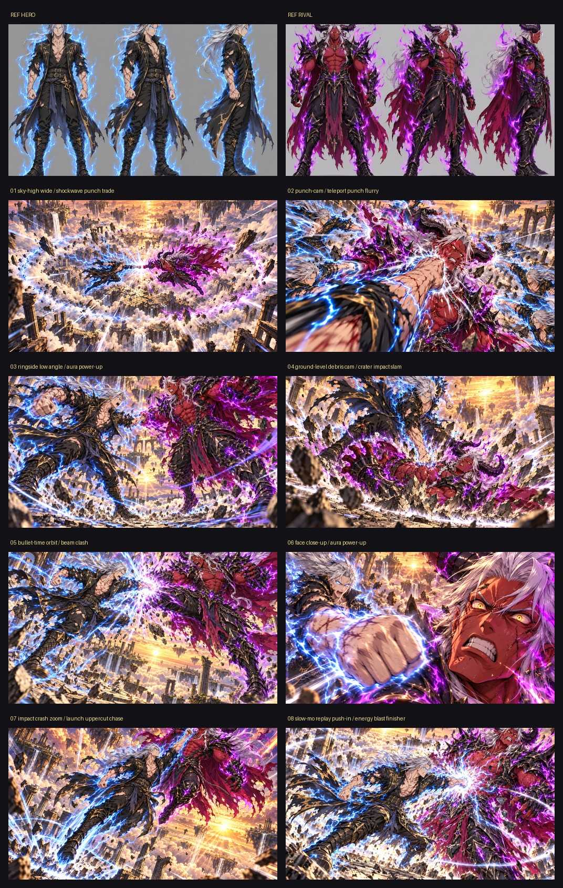

# Clash Rig

**Fight-scene cinematography for LTX-2.5: six fight styles, eleven arenas, fifteen camera rigs and hit-by-hit impact FX, with two identity refs that keep both fighters the same in every shot.**



*The default open-weights path: Z-Image Turbo draws the two fighter sheets (top), and Qwen Image Edit 2511 puts both fighters into every camera rig of an `anime_power` fight. Same designs, colors and auras in every shot.*



*The same matchup with the optional Codex plate backend (`--plate-backend codex`), eight shots.*
<!-- RENDER: clash-rig anime-sky local reel.mp4 -->

## What it rebuilds from Higgsfield

Higgsfield's pitch is controllable cinematic action: camera-move presets, a character that stays the same, and effects that sell the hit. Clash Rig rebuilds that for fights as open ComfyUI nodes:

- **Fight styles with their own beats and sound design**: boxing, muay thai, MMA, BJJ, kung fu wuxia, and the flagship `anime_power` (energy auras, beam clashes, shockwave rings, crater impacts, levitating debris).
- **15 camera rigs**: ringside low angle, glove punch-cam, over-the-shoulder, impact crash zoom, bullet-time orbit, overhead, replay push-in, sky-high wide, debris cam, face close-up, shoulder cam, low-angle upshot, whip-pan profile, rival POV, drone dive.
- **11 arenas** or your own text, 8 lights, 6 visual styles, an 8-shot fight arc per style.
- **Impact FX** (`ClashFX`): hit flashes, camera shake with a jolt on every hit, chromatic punch, radial speed lines, anime impact frames, speed ramp. Frame count unchanged, so LTX audio stays in sync.
- **Identity lock**: a character sheet per fighter (Z-Image Turbo, or your own photo), both passed to Qwen Image Edit for every plate.

## Nodes

| Node | What it does |
|---|---|
| `ClashRig` | fight style + hero + rival + arena + camera rig + beat -> first-frame prompt, LTX motion prompt, negatives, sizes, frames, seed, FX defaults |
| `ClashRigBuilder` | your own rig: mount anchor, camera pitch, lens, mount stability |
| `ClashFX` | hit flashes, shake, chromatic punch, speed lines, impact frames, speed ramp |
| `ClashReel` | hard-cuts the last N saved shots into one reel, trims LTX's wake-up frames, keeps the audio |
| `ClashRigList` | every fight style, beat, rig and arena as text |
| `ClashPlate` | optional: off-GPU first frame via the Codex CLI (closed model). Not used by the open workflows |

## Workflows (`workflows/`, UI and `_api` JSON)

| Workflow | Graph | Model files it loads |
|---|---|---|
| `clash_rig_fight` (**open, start here**) | hero + rival refs -> Qwen Image Edit 2511 (+ Lightning LoRA) -> LTX-2.5 + audio -> Clash FX | Qwen-Image-Edit-2511-Lightning-4steps-V1.0-bf16, gemma4-12b-with-proj-ltx-2.5-bf16, ltx-2.5-22b-distilled-transformer-bf16, ltx-2.5-audio-vae-bf16, ltx-2.5-latent-spatial-upscaler-x2-bf16-1.0, ltx-2.5-video-vae-bf16, qwen_2.5_vl_7b, qwen_image_edit_2511_bf16, qwen_image_vae |
| `clash_rig_shot` | Z-Image Turbo first frame, no refs -> LTX-2.5 -> Clash FX | ae, gemma4-12b-with-proj-ltx-2.5-bf16, ltx-2.5-22b-distilled-transformer-bf16, ltx-2.5-audio-vae-bf16, ltx-2.5-latent-spatial-upscaler-x2-bf16-1.0, ltx-2.5-video-vae-bf16, qwen_3_4b, z_image_turbo_bf16 |
| `clash_rig_builder` | the fight graph driven by Clash Rig Builder (custom mount and lens) | Qwen-Image-Edit-2511-Lightning-4steps-V1.0-bf16, gemma4-12b-with-proj-ltx-2.5-bf16, ltx-2.5-22b-distilled-transformer-bf16, ltx-2.5-audio-vae-bf16, ltx-2.5-latent-spatial-upscaler-x2-bf16-1.0, ltx-2.5-video-vae-bf16, qwen_2.5_vl_7b, qwen_image_edit_2511_bf16, qwen_image_vae |
| `clash_rig_reel` | Clash Reel: stitch saved shots (no model) | none |
| `clash_rig_fight_codex` (optional, closed) | Clash Plate (Codex CLI) first frame -> LTX-2.5 -> Clash FX | gemma4-12b-with-proj-ltx-2.5-bf16, ltx-2.5-22b-distilled-transformer-bf16, ltx-2.5-audio-vae-bf16, ltx-2.5-latent-spatial-upscaler-x2-bf16-1.0, ltx-2.5-video-vae-bf16 plus a Codex install |

Set `shot_index` to *increment* and queue 8 runs for a full fight arc, then run the reel workflow.

## Models

| File | Folder | What | Download | License |
|---|---|---|---|---|
| `ltx-2.5-22b-distilled-transformer-bf16.safetensors` | `models/diffusion_models/` | LTX-2.5 22B distilled video+audio transformer | [source](https://huggingface.co/Lightricks/LTX-2.5) | LTX-2.5 license (Lightricks); read the model card |
| `ltx-2.5-video-vae-bf16.safetensors` | `models/vae/` | LTX-2.5 video VAE | [source](https://huggingface.co/Lightricks/LTX-2.5/resolve/main/vae/ltx-2.5-video-vae-bf16.safetensors) | LTX-2.5 license |
| `ltx-2.5-audio-vae-bf16.safetensors` | `models/vae/` | LTX-2.5 audio VAE | [source](https://huggingface.co/Lightricks/LTX-2.5/resolve/main/vae/ltx-2.5-audio-vae-bf16.safetensors) | LTX-2.5 license |
| `ltx-2.5-latent-spatial-upscaler-x2-bf16-1.0.safetensors` | `models/latent_upscale_models/` | LTX-2.5 x2 spatial latent upscaler | [source](https://huggingface.co/Lightricks/LTX-2.5/resolve/main/latent_upscale_models/ltx-2.5-latent-spatial-upscaler-x2-bf16-1.0.safetensors) | LTX-2.5 license |
| `gemma4-12b-with-proj-ltx-2.5-bf16.safetensors` | `models/text_encoders/` | Gemma text encoder with LTX projection | [source](https://huggingface.co/Lightricks/LTX-2.5) | Gemma Terms of Use + LTX-2.5 license |
| `z_image_turbo_bf16.safetensors` | `models/diffusion_models/` | Z-Image Turbo (fast stills, 8 steps) | [source](https://huggingface.co/Comfy-Org/z_image_turbo) | Apache-2.0 (check card) |
| `qwen_3_4b.safetensors` | `models/text_encoders/` | Qwen3 4B text encoder for Z-Image | [source](https://huggingface.co/Comfy-Org/z_image_turbo) | Apache-2.0 (check card) |
| `ae.safetensors` | `models/vae/` | Z-Image VAE | [source](https://huggingface.co/Comfy-Org/z_image_turbo) | check card |
| `qwen_image_edit_2511_bf16.safetensors` | `models/diffusion_models/` | Qwen Image Edit 2511 (multi-reference edit) | [source](https://huggingface.co/Comfy-Org/Qwen-Image-Edit_ComfyUI) | Apache-2.0 (check card) |
| `qwen_2.5_vl_7b.safetensors` | `models/text_encoders/` | Qwen2.5-VL 7B text encoder for Qwen Image Edit | [source](https://huggingface.co/Comfy-Org/HunyuanImage_2.1_ComfyUI) | Apache-2.0 (check card) |
| `qwen_image_vae.safetensors` | `models/vae/` | Qwen Image VAE | [source](https://huggingface.co/Comfy-Org/Qwen-Image_ComfyUI) | Apache-2.0 (check card) |
| `Qwen-Image-Edit-2511-Lightning-4steps-V1.0-bf16.safetensors` | `models/loras/` | Lightning 4-step LoRA for Qwen Image Edit 2511 | [source](https://huggingface.co/lightx2v/Qwen-Image-Edit-2511-Lightning) | check card |

No weights are shipped here. Licenses are as we read the model cards on 2026-10-28; check each card before you redistribute anything. File names must match exactly because the loader nodes in the workflows name them; the download pages hold the same files or the closest published variant, so rename if a page ships another precision.

## Install

Needs Python 3.11+, [uv](https://docs.astral.sh/uv/), ffmpeg on PATH, and a ComfyUI that has the models below (ComfyUI 0.35 or newer).

```bash
git clone https://github.com/jk-automations/clash-rig && cd clash-rig

# 1. the ComfyUI custom nodes: symlink the pack into ComfyUI and restart it
ln -s "$PWD/custom_nodes/comfyui-clash-rig" ~/ComfyUI/custom_nodes/comfyui-clash-rig

# 2. the runner + web app
uv venv && uv pip install -e ".[proxy]"      # .[proxy] adds comfy-api-proxy; plain -e . if you already run one
```

The nodes need only torch, numpy and Pillow, which ComfyUI already has. The runner and the app talk to ComfyUI through the Comfy SDK, which speaks Comfy API v2,
so start the API v2 proxy in front of your ComfyUI (what `ops/serve.sh` does; it supervises both processes):

```bash
COMFYUI_DIR=~/ComfyUI ops/serve.sh start     # ComfyUI on :8198, comfy-api-proxy on :8195
export COMFY_BASE_URL=http://127.0.0.1:8195  # the default; Comfy Cloud or a serverless URL works the same way
ops/serve.sh status
```

Put the model files from the table above into `ComfyUI/models/<folder>/`. The open quickstart (`clash_rig_fight`, the runner's default) needs the LTX set, the Z-Image set (sheets) and the Qwen set (plates).

## Web app

```bash
.venv/bin/python app/server.py --port 8812            # http://127.0.0.1:8812
.venv/bin/python app/server.py --port 8812 --dry-run  # same UI, placeholder outputs, never contacts ComfyUI
```

One page: the controls (their choices are read from the pack's library), uploads, a Render button that runs the runner as a background job, live progress over SSE
(stage, ComfyUI node and sampler step), the **executed ComfyUI graph** of every submit read from the saved `*.graph.json` files (click a node for its inputs, download the
API JSON to open it in ComfyUI), and a gallery of every run under `runs/`, including runs started from the command line. The stack panel names the models and nodes behind each stage.

**Replay mode** (`--replay-from <finished run dir>`): every Render copies that finished run (refs, plates, clips, `shots.json`, `*.graph.json`) into the new job and runs the real runner on the cache, with the same arguments. It finishes in seconds, shows the real plates, the real executed graphs and the real reel, and submits nothing: `RIG_REPLAY=1` makes the Comfy layer refuse to submit, so a missing cached file aborts the job instead of rendering. The app shows a "replaying a finished render" badge. Used for demo recordings.

```bash
.venv/bin/python app/server.py --port 8811 --replay-from runs/clash-rig/anime-sky-v1
```

## Command line

The default plate backend is `local`, open weights end to end:

```bash
# eight-shot anime power fight on floating sky islands
.venv/bin/python -m clashrig --style-fight anime_power --arena "floating sky islands" --shots 8 --seed 7 --out runs/clash-rig/fight1

# a boxing match, stills only first (check the plates before spending LTX time), then re-run without --plates-only to finish: cached files are reused
.venv/bin/python -m clashrig --style-fight boxing --shots 4 --plates-only --out runs/clash-rig/boxing-v1

# put yourself in the fight
.venv/bin/python -m clashrig --style-fight mma --hero-photo me.png --rival "an original masked heavyweight in a grey gi" --shots 6 --out runs/clash-rig/me

# build and save the real graphs, write placeholder outputs, contact no server
.venv/bin/python -m clashrig --shots 2 --out /tmp/cr-dry --dry-run
```

Optional closed path: `--plate-backend codex` makes the sheets and plates with the Codex CLI instead (off-GPU, up to 3 in parallel). It runs `codex exec --dangerously-bypass-approvals-and-sandbox`
in a temporary directory, so use it only if you are comfortable with that. The open path never touches it.

Every ComfyUI submit is saved as `<name>.graph.json` next to its output; the app's graph viewer reads them.

## Hardware

Developed on a Mac Studio (M3 Ultra, unified memory) with ComfyUI started as `--bf16-unet --cpu-vae`. Measured there: **LTX-2.5 22B distilled about 4.3 min per 3 s clip at 768x448** (two-stage, with audio), **a Qwen Image Edit plate about 1 min**.
The full model set is about 150 GB on disk, so this needs a machine with tens of GB of GPU or unified memory. Not tested on CUDA by us. An 8-shot fight is roughly 35-40 minutes of LTX time plus plates. The runner merges all plates into one ComfyUI prompt and all LTX clips into another (`comfy.run_many`), so renders play well with a shared GPU queue: two turns per fight instead of one per render. The saved `*.graph.json` of a merged render is the merged graph.

## Honest limitations

- The open `local` plate path passes both fighter sheets to Qwen Image Edit in one edit. That is untested for fusing: in Velocity Rig the same trick merged two vehicles into one (so Velocity passes only the hero), and two people may or may not fare better. Check the contact sheet with `--plates-only` before spending LTX time.
- Two fighters in one frame is hard for every image model; limbs tangle in close grapples.
- Image-to-video drifts toward slow motion; the prompts and negatives push against it, and the replay and bullet-time rigs deliberately allow it.
- The hero image above is from the optional Codex backend, not the open one; the open-weights contact sheet and reel are still to be added where marked.
- Sound is whatever LTX-2.5 generates for the prompt; impacts are plausible, not designed.
- Fighters are original designs by construction (no real people, franchises or gear in the prompts). A photo upload puts that person in the fight: only use photos you have the right to use.
- The web app is a local single-user tool that serializes jobs; the live node view depends on Comfy API v2 job events and is best-effort.

## Layout

```
custom_nodes/comfyui-clash-rig/   the ComfyUI pack (symlink this)
workflows/             UI + API JSON for every workflow
clashrig/                 runner, Comfy SDK layer (comfy.py), graph builders (graphs/)
app/                   FastAPI server + static web app
ops/serve.sh           ComfyUI + comfy-api-proxy supervisor
scripts/validate_workflows.py   offline workflow check against a /object_info snapshot
```

`python scripts/validate_workflows.py --object-info object_info.json --pack custom_nodes/comfyui-clash-rig workflows/*_api.json` checks class names, required inputs, links and combo values
without a server (use ComfyUI's python so the pack imports; save the snapshot with `curl :8198/object_info`).

MIT licensed, copyright 2026 JK Automations. Built for the Comfy open-source Higgsfield challenge.
